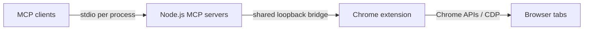

# BrowserMCP Extended · MCP Server

[](https://github.com/NEO10111/browsermcp-extended-mcp/actions/workflows/ci.yml)
[](LICENSE)
[](package.json)

**39 MCP tools for automating your existing browser and inspecting HTTP/WebSocket traffic through a local Chrome extension.**

BrowserMCP Extended connects an MCP-compatible AI client to the
[companion Chrome extension](https://github.com/NEO10111/browsermcp-extended-extension).
It runs locally over stdio, exchanges correlated commands through a loopback
WebSocket, and exposes browser operations as discoverable MCP tools. Existing
browser sessions are reused; no separate cloud browser or project API key is
required.

This is an independent modified distribution. See [NOTICE](NOTICE) for Browser
MCP and Playwright MCP credits. Version **2.0.0** pairs with the **2.x extension**.

## Capabilities

| Category | Tools | Examples |
| --- | ---: | --- |
| Navigation and references | 11 | Navigate, snapshot, click, type, select, drag, keyboard |
| Tabs | 4 | List, switch, open, close |
| DOM, frames, files | 5 | Read text/HTML, scroll, evaluate in a frame, assign a file input |
| Cookies and storage | 4 | Read cookies/storage; document.cookie-based write/delete |
| Screenshots | 3 | Viewport, full-page request, element location plus viewport image |
| Advanced interactions | 4 | CSS drag/drop, dialogs, clipboard, cache-bypassing reload |
| JavaScript and console | 2 | Evaluate expressions and read logs captured during evaluations |
| Network capture | 6 | Start, stop, list, detail, clear, HAR export |

The authoritative [tool reference](docs/TOOLS.md) documents all **39 unique tool
names**, parameters, required fields, and examples. [Known limitations](docs/LIMITATIONS.md)
describes behavior that differs from a full browser testing or DevTools product.

## Installation

Requirements: **Node.js 22+**, a recent desktop **Chrome or Chromium**, an MCP
client with stdio support, and the companion extension installed in that browser.

```sh
git clone https://github.com/NEO10111/browsermcp-extended-mcp.git
cd browsermcp-extended-mcp
npm ci
```

There is no build step. This repository is installed from source; the README does
not assume an npm registry release. The package is marked private to prevent
accidental publication.

Clone and load the extension separately:

```sh
cd ..
git clone https://github.com/NEO10111/browsermcp-extended-extension.git
```

In `chrome://extensions`, enable Developer mode, click **Load unpacked**, and
choose the extension directory. Open its popup and turn automation **On**.

## Client configuration

### Codex

Add this table to `~/.codex/config.toml` and restart Codex:

```toml
[mcp_servers.browsermcp-extended]
command = "node"
args = ["/absolute/path/browsermcp-extended-mcp/server.js", "--execute-port", "9877"]
```

Use an absolute Node executable path if the client does not inherit your shell's
PATH. Merge the entry into existing configuration rather than replacing it.

### Other stdio MCP clients

Adapt the client-specific configuration location and use this server definition:

```json
{
  "mcpServers": {
    "browsermcp-extended": {
      "command": "node",
      "args": ["/absolute/path/browsermcp-extended-mcp/server.js", "--execute-port", "9877"]
    }
  }
}
```

The MCP client launches the process and owns stdin/stdout. Running `npm start`
in a terminal is useful for startup diagnostics, but it does not register tools
with a client by itself. Logs go to **stderr**; stdout is reserved for MCP traffic.

### Port and multiple clients

The default address is **`127.0.0.1:9877`**. Set a different port with
`--execute-port N` or the compatible `--port N` alias, then update the extension
popup to match. The server does not kill a process occupying the port.

Multiple server processes can share one compatible local bridge. The first owns
the browser socket; peers relay their requests through it. A remaining peer can
retake the port if the owner exits. Sessions share browser state and per-tab
captures; they are not isolated users or separate browser profiles.

## First-use examples

Ask your MCP client to list tabs, select a tab, generate a snapshot, and click or
type using references from that snapshot. Regenerate a snapshot after navigation
or significant DOM changes.

A direct tool invocation uses the MCP name and arguments:

```json
{"name":"browser_list_tabs","arguments":{}}
```

```json
{"name":"browser_snapshot","arguments":{}}
```

```json
{"name":"browser_type","arguments":{"element":"Search field","ref":"e1","text":"MCP","submit":false}}
```

`e1` above is illustrative; use the actual reference returned by your page.
JavaScript input is evaluated as an expression; wrap statements in an IIFE:

```json
{"name":"execute_script","arguments":{"code":"(() => ({title: document.title, url: location.href}))()"}}
```

## Network inspection

Capture must begin **before** the traffic you want to inspect:

```json
{"name":"browser_network_start","arguments":{"tabId":123,"captureBodies":true}}
```

Reload the selected tab or trigger the action being inspected:

```json
{"name":"browser_reload","arguments":{"hard":true}}
```

List and filter captured records:

```json
{"name":"browser_network_list","arguments":{"tabId":123,"resourceType":"Fetch","status":200,"limit":50}}
```

Pass an exact returned `id` to inspect headers, POST data, response body, timing,
errors, and WebSocket frames:

```json
{"name":"browser_network_detail","arguments":{"tabId":123,"requestId":"12345.1:1"}}
```

```json
{"name":"browser_network_export_har","arguments":{"tabId":123,"filePath":"/absolute/path/capture.har"}}
```

```json
{"name":"browser_network_stop","arguments":{"tabId":123}}
```

`tabId` and `requestId` values are examples. `browser_reload` acts on the active
tab, so select the captured tab before reloading. HAR files are written on the
server machine; existing files are not overwritten. Without `filePath`, export
returns HAR JSON. See [network capture](docs/NETWORK.md) for limits and retention.

## Development and verification

```sh
npm ci
npm run check
npm test
npm run docs:tools
```

The integration suite starts real stdio MCP processes and a simulated extension
socket. It verifies tool discovery, command routing, port conflicts, concurrent
clients, and ownership takeover. CI runs these checks on Node.js 22 and 24.

Run the real Chromium/extension test with both repositories checked out:

```sh
BROWSERMCP_EXTENSION_PATH=../browsermcp-extended-extension npm run test:browser
```

The test uses `/usr/bin/chromium` by default; override with `CHROMIUM`. It launches
an isolated browser profile and local HTTP/WebSocket fixture, captures GET/POST,
redirects, 404s and WebSocket frames, verifies screenshot coexistence and response
content, then writes and reads a HAR file. No real account or internet site is
needed for the fixture. The companion extension's unit suite runs in its own repo.

## Architecture and safety



The browser profile is the user's real profile. The bridge has **no authentication
or Origin allowlist** and must remain private to a trusted machine. Network
records may contain credentials and sensitive response content. Data returned to
the MCP client may be sent to that client's model provider. See
[SECURITY.md](SECURITY.md), [architecture](docs/ARCHITECTURE.md), and
[troubleshooting](docs/TROUBLESHOOTING.md).

## Contributing and license

See [CONTRIBUTING.md](CONTRIBUTING.md), [CHANGELOG.md](CHANGELOG.md),
[LICENSE](LICENSE), and [THIRD_PARTY_NOTICES.md](THIRD_PARTY_NOTICES.md).
